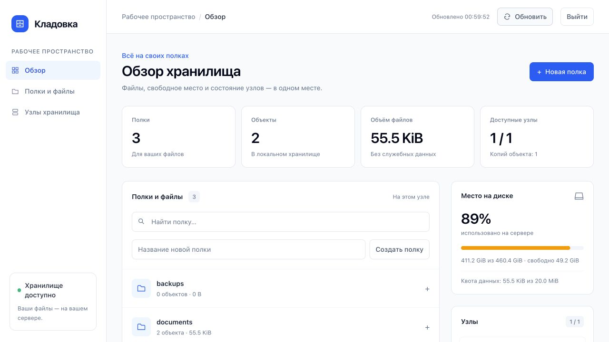
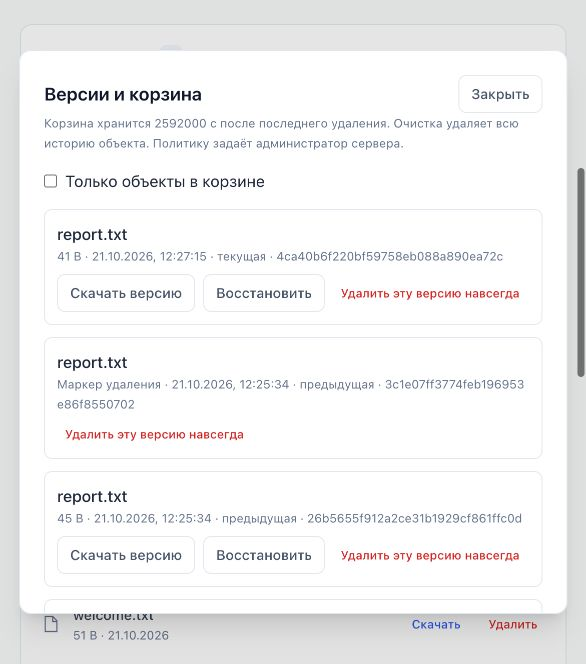

# Инструкция пользователя

Редакция 21 октября 2026 года. Руководство описывает актуальную сборку репозитория, включая изменения после опубликованной v0.4.0. Наличие функций сверяйте с администратором по версии и commit установленного бинарника. CopyObject, DeleteObjects, группировка LIST и режим планового обслуживания появились после v0.4.0. Этот документ не означает выпуск нового релиза.


Руководство рассчитано на читателя файлов, автора файлов и администратора панели. Для повседневной работы нужны адрес хранилища и собственные реквизиты. Настройка серверов находится в [руководстве администратора](ADMIN.md).

## Навигация

- [Получение доступа](#1-перед-началом)
- [Панель и сеанс](#2-панель-в-браузере)
- [Имена и ограничения](#3-имена-и-ограничения)
- [AWS CLI и ссылки](#4-aws-cli)
- [Multipart](#5-multipart-загрузка)
- [Ошибки](#6-ошибки)
- [Кластер и RF для пользователя](#7-работа-с-кластером-и-rf)
- [Сценарии и проверка результата](#8-повседневные-сценарии-и-проверка-результата)
- [Копирование](#9-копирование-объектов)
- [Массовое удаление](#10-массовое-удаление)
- [Папки и страницы](#11-папки-и-страницы-списка)
- [Приложение на Python](#12-пример-приложения-на-python)
- [Приёмка доступа и памятка](#13-приёмка-доступа-и-памятка)
- [Версии, корзина и восстановление](#14-версии-корзина-и-восстановление)

## Быстрый маршрут

Если вам выдали S3-ключи reader/writer, начните с [AWS CLI](#4-aws-cli): панель доступна администратору. Для первой загрузки используйте новый ключ, скачайте файл обратно и сравните SHA-256. При 503 перейдите к [правилам безопасного повтора](#повтор-после-503-или-потери-соединения), прежде чем повторять изменение.

## 1. Перед началом

Перед первой загрузкой запишите:

- основной endpoint с протоколом и портом;
- разрешённые запасные endpoint и регион подписи;
- Access Key ID и Secret Access Key, выданные лично вам;
- имена доступных полок и роль;
- предельный размер объекта и порядок обращения в поддержку.

| Действие | Reader | Writer | Admin |
|---|---|---|---|
| Список и чтение в разрешённой полке | Да | Да | Да |
| Загрузка, перезапись, удаление, multipart | Нет | Да | Да |
| Создание и удаление полок | Нет | Нет | Да |
| Панель, метрики и управление кластером | Нет | Нет | Отдельные реквизиты панели или соответствующий административный API |

S3 admin в файле политики не создаёт пароль для формы входа. Writer имеет доступ ко всей разрешённой полке, а не только к загруженным им объектам. Для разных групп доступа администратор создаёт разные полки.


Получите у администратора адрес хранилища, Access Key ID, Secret Access Key и регион (обычно `us-east-1`). Уточните роль и разрешённые полки: reader даёт чтение, writer — чтение, запись и удаление объектов в этих полках, admin — полный доступ. Без настроенного разграничения действует общая пара полного доступа. Не передавайте ключи другим пользователям и не помещайте их в Git. Смена или отзыв ключа применяется и к ранее выданным подписанным ссылкам.

Полка — контейнер файлов (S3 bucket). Ключ — имя объекта внутри полки, например `photos/holiday.jpg`. Папки являются частями ключа. При включённой версионности запись создаёт новое поколение, а прежнее остаётся в истории. Обычный DELETE создаёт маркер удаления и помещает объект в корзину. Подробнее — раздел 14.

## 2. Панель в браузере



Снимок показывает расположение элементов; счётчики на нём являются примером.

1. Откройте `https://<адрес>/ui/` (порт уточните у администратора).
2. В форме входа введите имя и пароль администратора панели. S3-ключи с ролями reader/writer предназначены для S3-клиентов и не дают входа в панель. В режиме общей пары без отдельного администратора имя — Access Key ID, пароль — Secret Access Key.
3. В блоке «Полки» введите имя и нажмите «Создать» или Enter.
4. Нажмите на полку: появятся объекты и действия с файлами.
5. Нажмите «Выберите файлы» в раскрытой полке или перетащите файлы в эту область. Загрузка начинается после выбора. Для вложенного ключа сначала укажите папку, например `photos/`.
6. Нажмите «Скачать» рядом с нужным объектом. Кнопка «Удалить» запрашивает подтверждение. При включённой версионности объект попадает в корзину; в установке без версионности удаление необратимо.
7. Удалить полку можно кнопкой «Удалить полку» после удаления её объектов и всех сохранённых версий/маркеров.

Поле «Найти полку» фильтрует названия. Список показывает до 100 объектов за страницу; «Ещё 100» загружает следующую. Слева на большом экране находятся переходы к обзору, полкам и узлам. Карточка узла открывает его панель. При обращении к другому адресу браузер может снова запросить реквизиты.

Панель обновляет статистику раз в пять секунд. Автообновление можно выключить; кнопка «Обновить» обновляет данные вручную. Во время выбора файлов, ввода и загрузки фоновые обновления приостанавливаются, чтобы не сбивать действие. Дождитесь уведомления о результате загрузки; при ошибке проверьте список перед повтором.

Карточки показывают количество полок и объектов, доступные узлы, uptime, HTTP/S3-счётчики и трафик. Диск — вся файловая система сервера, а не только ваши файлы. «Доступно службе» учитывает пространство, зарезервированное файловой системой; «неизвестно» означает, что измерение не удалось. Если администратор установил квоту данных, она показана отдельно и включает незавершённые multipart-части. Счётчики трафика относятся к периоду с запуска процесса. В legacy-режиме список и статистика текущей ноды могут отличаться от других. В consensus каталог общий, а диск и счётчики относятся к обслужившему запрос узлу.

Кнопка «Выйти» в верхней панели завершает текущий сеанс. По умолчанию он действует 8 часов с момента входа; срок устанавливает администратор. После истечения срока или перезапуска сервера появится форма входа. На общей машине выходите из панели после работы. При переходе на другой узел нужен отдельный вход; персональные S3-ключи выдаёт администратор.

## 3. Имена и ограничения

Для совместимости с клиентами используйте имена полок из латинских строчных букв, цифр и дефисов, например `documents`. Не используйте имена `api`, `ui`, `internal`, `healthz`, `cluster`, `metrics`, имена с начальной точкой, `..` и разделителями пути.

В ключах не используйте пустые сегменты, `..`, сегмент `.` и служебные окончания `.tmp`, `.kladovka-meta.json`. Например, `photos/2026/image.jpg` подходит. Не храните одновременно объект `photos` и вложенный объект `photos/image.jpg`: они конфликтуют в файловом представлении.

Максимальный размер объекта задаёт администратор. В новой сборке версии и корзина включены по умолчанию; для старой установки уточните настройку у администратора. В актуальной сборке доступны серверное копирование и массовое удаление с ограничениями разделов 9–10. Версии и корзина описаны в разделе 14. ACL не реализованы. Расширенные функции AWS S3 нельзя считать поддерживаемыми только потому, что клиент показывает соответствующую кнопку.

## 4. AWS CLI

Используйте установленный AWS CLI с поддержкой S3. Пример ниже создаёт отдельный профиль и не меняет настройки других профилей:

```bash
aws configure --profile kladovka
# AWS Access Key ID: значение от администратора
# AWS Secret Access Key: значение от администратора
# Default region: us-east-1 (либо регион администратора)
# Default output: json
aws configure set s3.addressing_style path --profile kladovka
```

Перед командами задайте endpoint и профиль:

```bash
export ENDPOINT=https://storage.example.org:8443
export AWS_PROFILE=kladovka
# Не запрашивать необязательные современные checksum/streaming-возможности S3.
export AWS_REQUEST_CHECKSUM_CALCULATION=when_required
export AWS_RESPONSE_CHECKSUM_VALIDATION=when_required
```

Адрес в примере замените адресом администратора. На локальном стенде допустим `http://127.0.0.1:8000`. Проверку TLS не отключайте; если используется внутренний CA, получите сертификат CA у администратора и задайте `AWS_CA_BUNDLE=/путь/к/ca.pem`.

Ниже приведены операции для разных ролей. Создание полки выполняет admin; загрузка и удаление требуют writer или admin; чтение и список доступны reader. Используйте имя полки, разрешённое вашей учётной записи.

Основные операции:

```bash
# Создать полку.
aws --endpoint-url "$ENDPOINT" s3 mb s3://documents

# Загрузить файл с вложенным ключом.
aws --endpoint-url "$ENDPOINT" s3 cp ./report.pdf s3://documents/reports/report.pdf

# Список объектов, включая вложенные ключи.
aws --endpoint-url "$ENDPOINT" s3api list-objects-v2 --bucket documents

# Отфильтровать по началу ключа.
aws --endpoint-url "$ENDPOINT" s3api list-objects-v2 --bucket documents --prefix reports/

# Скачать файл.
aws --endpoint-url "$ENDPOINT" s3 cp s3://documents/reports/report.pdf ./report-downloaded.pdf

# Метаданные объекта.
aws --endpoint-url "$ENDPOINT" s3api head-object --bucket documents --key reports/report.pdf

# Удалить конкретный объект, затем пустую полку.
aws --endpoint-url "$ENDPOINT" s3api delete-object --bucket documents --key reports/report.pdf
aws --endpoint-url "$ENDPOINT" s3api delete-bucket --bucket documents
```

`list-objects-v2` поддерживает prefix и постраничное чтение. Группировка через delimiter описана в разделе 11; без delimiter выдача остаётся плоской. Копирование и массовое удаление описаны в разделах 9–10; профиль работы с версиями описан в разделе 14; расширенные checksum API не заявлены. Полная совместимость со всеми командами AWS CLI не заявлена.

Скачать часть объекта:

```bash
aws --endpoint-url "$ENDPOINT" s3api get-object \
  --bucket documents --key reports/report.pdf --range bytes=0-1023 ./first-kib.bin
```

Создать временную ссылку на скачивание:

```bash
aws --endpoint-url "$ENDPOINT" s3 presign s3://documents/reports/report.pdf --expires-in 300
```

В течение срока действия ссылкой может воспользоваться любой её обладатель, пока ключ не отозван и права пользователя разрешают доступ. Не публикуйте её в открытом доступе. Поддерживается срок от 1 до 604800 секунд; подпись привязана к адресу и региону.

## 5. Multipart-загрузка

Multipart позволяет передавать объект частями. Клиенты могут выбирать его автоматически для больших файлов. Используйте одинаковый endpoint на всех этапах.

Для ручной загрузки через `s3api`:

1. Выполните `create-multipart-upload --bucket documents --key large.bin` и сохраните UploadId.
2. Для каждой части выполните `upload-part --bucket documents --key large.bin --upload-id <ID> --part-number <номер> --body <файл>`; сохраните ETag.
3. Проверьте части командой `list-parts` с теми же bucket/key/upload-id.
4. Создайте JSON-файл завершения с массивом `Parts`, содержащим `PartNumber` и точные ETag ответа, в возрастающем порядке номеров.
5. Выполните `complete-multipart-upload --bucket documents --key large.bin --upload-id <ID> --multipart-upload file://parts.json`.
6. Для отмены используйте `abort-multipart-upload --bucket documents --key large.bin --upload-id <ID>`.

К каждой команде добавляйте `aws --endpoint-url "$ENDPOINT" s3api` перед именем операции. Не считайте загрузку завершённой до успешного ответа CompleteMultipartUpload. Лимит размера применяется и к собранному объекту. После 503 на завершении можно повторить завершение с тем же UploadId и частями, когда связь восстановлена. При NoSuchUpload после потери ответа сначала проверьте готовый объект: успешное завершение могло уже удалить UploadId. Незавершённые загрузки занимают место; отменяйте ненужные. Загрузки без новых частей удаляются автоматически по сроку администратора (по умолчанию через 24 часа). После истечения срока нужно начать новую загрузку.

ETag multipart-объекта не равен MD5 всего файла. Для проверки целостности сравнивайте собственные SHA-256 исходного и скачанного файлов.

## 6. Ошибки

- `403 AccessDenied` в S3: ключ отозван, роль не разрешает действие или полка недоступна. Reader/writer не могут создавать и удалять полки; попросите администратора создать нужную полку.
- `401` или возврат на форму входа: сеанс завершён; войдите снова. При ошибке входа проверьте имя и пароль. После десяти попыток за минуту подождите минуту.
- `403 CSRF token required`: обновите страницу, затем повторите действие.
- `403 AccessDenied` / `InvalidAccessKeyId`: неверные ключи или истекшая ссылка.
- `SignatureDoesNotMatch`: проверьте endpoint, REGION, секрет и системное время; сообщите администратору, если между клиентом и сервером есть proxy.
- `NoSuchBucket` / `NoSuchKey`: проверьте регистр имени и точный ключ. В legacy список текущего узла может быть неполным; в consensus каталог общий.
- `BucketNotEmpty`: сначала удалите оставшиеся объекты.
- `507 InsufficientStorage`: достигнута квота, свободный резерв или общий лимит временных загрузок. Дождитесь завершения других загрузок либо обратитесь к администратору.
- `InvalidObjectState`: сервер обнаружил повреждение файла или метаданных; сообщите администратору, чтобы восстановить объект из проверенной копии.
- `413 EntityTooLarge`: превышен серверный лимит.
- `503 ServiceUnavailable`: проблема доступности узла или репликации; операция могла примениться частично. Для PUT повторите тот же файл с тем же ключом; для DELETE повторите удаление; для multipart повторите завершение, а при NoSuchUpload сначала проверьте готовый объект. Не повторяйте запись поверх более новой версии другого пользователя. При повторной ошибке обратитесь к администратору.

При обращении сообщите время ошибки, endpoint, имя полки, ключ, операцию и код ответа. Не прикладывайте секрет, заголовок Authorization или действующую presigned-ссылку.

## 7. Работа с кластером и RF

Администратор должен сообщить режим кластера, основной адрес, разрешённые запасные адреса и регион. Пользователь не меняет RF и не выбирает место хранения отдельного объекта.

### Consensus: общий каталог и автоматический failover

В consensus один лидер упорядочивает операции, а доступный участник пересылает ему клиентские запросы. LIST и каталог полок общие. RF=N означает целевое число полных копий на всех голосующих участниках:

- 3 узла: для работы нужны 2 голоса, допустима потеря одного узла.
- 4 узла: нужны 3 голоса, допустима потеря одного узла.
- 5 узлов: нужны 3 голоса, допустима потеря двух узлов.

Это условия доступности исправного большинства. Успех записи подтверждает большинство; отдельные реплики могут ещё получать данные. При возвращении узел автоматически догоняет журнал или снимок. Удалённые объекты не возвращаются из прежней копии благодаря отметкам удаления.

При отказе лидера участники выбирают нового. Во время выборов возможен 503. При потере большинства кластер отклоняет чтение и запись, даже если `/healthz` отвечает успешно. Доступный HTTP-сервер не обязательно может обслужить данные.

Если сам адрес, к которому вы обращаетесь, недоступен, используйте выданный администратором запасной endpoint или балансировщик. Автоматическая пересылка не помогает обратиться к остановленному входному серверу. AWS CLI создаст новую подпись для нового endpoint. В готовой presigned-ссылке нельзя вручную менять hostname или путь: запросите новую ссылку для доступного адреса.

Незавершённые multipart-части находятся на лидере и не реплицируются как готовый объект. После его потери может потребоваться новая загрузка. При NoSuchUpload после потери ответа сначала проверьте готовый объект: предыдущий CompleteMultipartUpload мог успешно завершиться.

Добавление, вывод и замена узлов относятся к работе администратора. Во время передачи лидерства возможен кратковременный 503. После вывода входного узла используйте оставшийся адрес или обновлённый балансировщик. Сведения о состоянии и действиях администратора — в [инструкции consensus](CONSENSUS.md).

### Legacy: локальный каталог и фиксированный primary

Следующие правила относятся только к `CLUSTER_MODE=legacy`.

RF — число полных копий готового объекта, включая primary, основной узел конкретного ключа. RF=2 означает две копии, а не две дополнительных. У разных ключей могут быть разные primary. Успешная запись ждёт primary и все назначенные реплики. При трёх узлах и RF=3 нужны все три, а при RF=2 объект находится на двух из трёх.

Несколько узлов с RF=1 работают независимо. Для межузловой пересылки и копирования в legacy требуется RF>1. При RF<N отдельный узел может не содержать часть объектов. LIST и статистика локальные: отсутствие объекта в списке одного узла не доказывает его отсутствие во всём кластере. Для полного каталога нужен объединённый список участников, согласованный с администратором.

При недоступности primary запись не переключается автоматически. Исправная реплика может выдавать объект, но не становится новым primary. Если primary сохранил объект, а реплика недоступна, клиент может получить 503 уже после локального изменения. Возврат узла не запускает автоматическую сверку и восстановление пропущенных изменений. Чтение с другого адреса также не исправляет прежнюю копию.

Не используйте локальный LIST как основание для массовой синхронизации с удалением. При аварии не заменяйте отсутствующий объект пустым файлом и не перезаписывайте все копии первой найденной версией.

### Проверка запасного адреса

Задайте `SECONDARY_ENDPOINT` адресом, который разрешил администратор. Для известного объекта:

```bash
export SECONDARY_ENDPOINT=https://s2.storage.example.org:8443
aws --endpoint-url "$SECONDARY_ENDPOINT" s3api head-object \
  --bucket documents --key reports/report.pdf
aws --endpoint-url "$SECONDARY_ENDPOINT" s3 cp \
  s3://documents/reports/report.pdf ./report-from-secondary.pdf
```

Сравните скачанные байты с исходником по SHA-256. На другом адресе панели нужен отдельный вход. Успешный GET проверяет чтение конкретного объекта через этот адрес, но не число исправных физических копий.

### Повтор после 503 или потери соединения

Эта процедура применяется к обоим режимам.

1. Сохраните исходный файл, полный ключ, время, endpoint и код ответа. Итог операции пока неизвестен: изменение могло произойти до потери ответа.
2. По возможности приостановите другие изменения этого ключа. После восстановления доступности проверьте HEAD и скачанные байты по SHA-256. Только размер и ETag недостаточны для проверки исходного содержимого.
3. Повторите PUT с **теми же байтами и ключом**, если никто не записал более новую версию. Повторите DELETE, только если объект не создавали заново. Безусловный повтор не защищает чужую новую запись.
4. Для multipart повторите завершение с тем же UploadId и ETag частей, если загрузка сохранилась. При NoSuchUpload сначала проверьте результат, затем при необходимости начните новую загрузку.
5. При продолжающихся ошибках прекратите бесконечные повторы и передайте диагностику администратору. Не удаляйте единственный исходник до проверки результата.

RF и failover не заменяют резервную копию. Успешные перезапись и удаление распространяются на реплики. Версии помогают отменить ошибку до окончательной очистки. Независимую резервную копию всё равно храните отдельно.

## 8. Повседневные сценарии и проверка результата

### Читатель

Попросите администратора заранее создать полку и выдать роль reader на неё. Используйте LIST, HEAD, скачивание и presigned GET. Создание полки, загрузка, multipart и удаление для reader запрещены; ошибка 403 здесь ожидаема и не устраняется повтором с другим адресом.

### Автор файлов

Для записи нужна роль writer на существующую полку или admin. Сначала используйте новый ключ, чтобы случайно не заменить рабочий файл. Загрузите объект, скачайте его в другое локальное имя и сравните суммы:

```bash
aws --endpoint-url "$ENDPOINT" s3 cp ./report.pdf s3://documents/reports/report.pdf
aws --endpoint-url "$ENDPOINT" s3 cp s3://documents/reports/report.pdf ./report-checked.pdf
sha256sum ./report.pdf ./report-checked.pdf
```

На macOS используйте `shasum -a 256`. Должны совпасть оба хеша. Совпадение проверяет байты скачанного объекта; число физических копий в кластере подтверждает администратор. ETag, особенно multipart ETag, не заменяет SHA-256 исходного файла.

Для обновления файла по существующему ключу заранее сохраните старый исходник отдельно. Обычные читатели используют текущую версию. При включённой версионности прежние поколения доступны по VersionId. Для независимых выпусков используйте разные ключи, например `reports/2026-10-20/report.pdf`.

### Удаление

Обычное удаление при включённой версионности переносит файл в корзину; окончательное удаление версии необратимо. Сначала уточните точный ключ и наличие нужной резервной копии. Удаляйте отдельные объекты через панель или `s3api delete-object`, а полку — только когда она пуста и вы имеете роль admin. В legacy-кластере пустой список одной ноды не подтверждает, что полка пуста на остальных.

Не используйте непроверенные команды массовой синхронизации с удалением: в legacy-режиме каталог может быть локальным. DeleteObjects доступен в актуальной сборке с ограничениями раздела 10. При частичном отказе удаления реплика может ещё содержать старый файл; сообщите администратору и согласованно повторите операцию, а не пытайтесь исправлять файлы на дисках самостоятельно.

### Обращение в поддержку

Передайте администратору: время с часовым поясом, адрес узла, полку и полный ключ, тип операции, HTTP/S3-код, примерный размер, наличие исходника/ожидаемого SHA-256, факт повторов и сведения о других писателях этого ключа. Для multipart — UploadId и номера частей; передавайте их по согласованному закрытому каналу. Пароли, Secret Access Key, cookies, Authorization, CSRF-токен и действующую presigned-ссылку в отчёт не включайте.

Администратору доступна [инструкция по кластеризации и RF](ADMIN.md#6-кластеризация-и-rf), проверке локальных копий и восстановлению. Пользователь не должен менять RF, PEER_NODES, права файлов или содержимое DATA_ROOT для устранения ошибки клиента.


### Плановое обслуживание узла

При плановом обслуживании выбранный адрес временно отвечает 503 и Retry-After: 5 на запросы к данным. Используйте настроенный администратором общий endpoint или другой действующий узел. Панель и статистика остаются доступны. Дождитесь восстановления доступности перед повтором операции; если ответ на запись потерян, проверьте объект. Уже начатые multipart-загрузки согласуйте с администратором до смены лидера.


Проверенные версии AWS CLI, boto3 и MinIO Python SDK, настройки и границы поддержки описаны в [S3_CLIENTS.md](S3_CLIENTS.md). Контрактные проверки добавлены после v0.4.0; исправлено повторное URL-декодирование ключей с `%`.


## 9. Копирование объектов

Серверное копирование доступно в актуальной сборке. Можно копировать объект в той же полке или между полками **одного хранилища**. Пользователю нужны чтение исходной полки и запись целевой; наличие прав только на назначение не даёт доступа к чужим данным. Полка назначения должна существовать.

```bash
aws --endpoint-url https://storage.example.org s3api copy-object \
  --bucket archive --key report.txt --copy-source documents/report.txt
```

Для имён с пробелами, `%`, `+` или кириллицей URL-кодируйте значение copy-source ровно один раз. В boto3 удобнее передать `CopySource={'Bucket': 'documents', 'Key': 'отчёт + 100%.txt'}` — SDK кодирует заголовок сам. В MinIO Python используйте `CopySource(bucket, key)`.

Копия содержит байты выбранного поколения источника. По умолчанию переносится Content-Type (`MetadataDirective=COPY`). Для его замены укажите `--metadata-directive REPLACE --content-type application/json`. При REPLACE без Content-Type используется application/octet-stream. Копирование текущего объекта в самого себя допускается с REPLACE; копирование указанной версии в тот же ключ также допускается и создаёт новое поколение. Произвольные пользовательские metadata и другие свойства этим профилем не поддерживаются: запрос таких свойств возвращает 501.

Поддержаны условия **источника** CopySourceIfMatch, CopySourceIfNoneMatch, CopySourceIfModifiedSince и CopySourceIfUnmodifiedSince. Несовпадение возвращает 412 без перезаписи назначения; неверная дата — 400. Условие ETag имеет приоритет над соответствующим условием даты. Условия назначения If-Match/If-None-Match пока возвращают 501; это не операция compare-and-swap. Параллельная запись назначения может быть перезаписана копией.

Успех — HTTP 200 с XML CopyObjectResult, ETag и LastModified **после завершения записи**. Читайте полный ответ через SDK. Копия получает новый обычный ETag, в том числе при копировании multipart-источника; ETag исходной multipart-загрузки не переносится. При потере ответа операция могла выполниться: проверьте назначение, прежде чем повторять запрос. Повтор без условия может взять уже изменившийся источник.

Максимум одной копии — 5 GiB и не больше MAX_OBJECT_SIZE установки. Используются квоты, лимит временного места, свободного диска и число одновременных загрузок. Перед публикацией назначения сервер проверяет SHA-256 источника. Ошибка чтения, условия или лимита до публикации сохраняет прежнее назначение. После локальной записи в legacy сбой репликации возвращает 503; локальная копия при этом уже может существовать.

UploadPartCopy, versionId источника, ACL, шифрование по заголовкам SSE, теги, нестандартный storage class, расширенные checksum-параметры и пользовательские metadata не поддерживаются и явно отклоняются. Это копирование внутри хранилища; для переноса между независимыми endpoint используйте GET и PUT.

## 10. Массовое удаление

Массовое удаление принимает 1–1000 ключей одной полки в XML до 2 МиБ. Нужны права writer на полку или administrator. Пример с явно выбранными ключами:

```sh
aws --endpoint-url "$ENDPOINT" s3api delete-objects --bucket documents \
  --delete '{"Objects":[{"Key":"archive/report.pdf"},{"Key":"archive/old.txt"}],"Quiet":false}'
```

Отсутствующий объект считается успешно удалённым. HTTP 200 означает, что пакет обработан: обязательно проверьте массив `Errors`. `Quiet:true` убирает успешные результаты, но сохраняет ошибки. Повторяющиеся ключи удаляются один раз, результат возвращается для каждого вхождения. Ключи в XML передаются буквально: `a%2Fb` отличается от `a/b`.

Пакет не является транзакцией. При ошибке одного ключа другие могут быть удалены. После потери ответа или ServiceUnavailable удаление могло уже произойти; проверьте состояние и повторяйте только неподтверждённые ключи, согласовав повтор с другими писателями, чтобы не удалить новую версию файла. На обработку выделяется бюджет 20 секунд; уже начатая локальная операция может завершиться позже. Не начатые операции получают ServiceUnavailable.

Сервер проверяет весь XML и контрольные суммы до удаления. Поддерживаются Content-MD5, CRC32, CRC32C, CRC64NVME, SHA1 и SHA256; хотя бы одна сумма обязательна. Обычные AWS CLI, boto3 и MinIO SDK формируют её автоматически. При UNSIGNED-PAYLOAD контрольная сумма должна входить в SignedHeaders. Неправильная сумма или структура отклоняет весь запрос. VersionId, условия по ETag/размеру/времени, MFA и расширенные x-amz-заголовки не поддерживаются и отклоняются до изменений. Неподдерживаемое имя отдельного ключа возвращает InvalidArgument в Errors.

## 11. Папки и страницы списка

В S3 папка — это общий префикс ключей. `delimiter=/` объединяет вложенные объекты в `CommonPrefixes`; файлы текущего уровня остаются в `Contents`. Пустые каталоги и незавершённые multipart-загрузки в список не входят. Доступен любой строковый delimiter, не только `/`.

```sh
# Папки и файлы верхнего уровня.
aws --endpoint-url "$ENDPOINT" s3 ls s3://documents/

# Содержимое reports/; CLI автоматически получает все страницы.
aws --endpoint-url "$ENDPOINT" s3api list-objects-v2 \
  --bucket documents --prefix reports/ --delimiter / --page-size 100

# Одна страница для собственного клиента.
aws --endpoint-url "$ENDPOINT" s3api list-objects-v2 \
  --bucket documents --delimiter / --max-keys 100 --no-paginate
```

Одна папка занимает одно место на странице, даже если содержит тысячи файлов. `MaxKeys` ограничивает сумму файлов и префиксов: по умолчанию и максимум 1000; 0 возвращает пустую страницу. Отрицательные и некорректные значения отклоняются. `KeyCount` в V2 — число элементов текущей страницы. Порядок соответствует лексикографическому порядку UTF-8 ключей.

Если `IsTruncated=true`, передайте `NextContinuationToken` как `continuation-token` следующего запроса и сохраните полку, prefix и delimiter. Токен непрозрачный: не заменяйте его последним именем и не разбирайте самостоятельно. Размер страницы и encoding-type можно менять. Для первой страницы можно указать `start-after`; папки, чьи префиксы не больше этого значения, также исключаются. Если переданы и токен, и start-after, положение определяет токен.

Для старого ListObjects (без `list-type=2`) используется `marker`. При delimiter сервер возвращает `NextMarker`; без delimiter используйте последний `Contents.Key`. Полей KeyCount и ContinuationToken в V1 нет. boto3 paginator и MinIO `list_objects(..., recursive=False)` обрабатывают страницы; `recursive=True` возвращает плоский список.

`encoding-type=url` кодирует имена, префиксы, delimiter и маркеры в UTF-8 percent-encoding. Декодируйте их ровно один раз; стандартные SDK делают это сами, когда автоматически запрашивают encoding. Буквальный `%2F` в имени не является разделителем. Токены продолжения не декодируйте как имена объектов.

Страницы не образуют неизменяемый снимок: параллельные записи и удаления могут изменить последующие результаты. Токен не даёт прав доступа — каждый запрос проверяется заново. После обновления с v0.4.0 начните обход заново: прежние токены в виде ключа несовместимы с новым форматом. `fetch-owner=true` пока возвращает NotImplemented.


## 12. Пример приложения на Python

Проверенные версии библиотек и ограничения находятся в [S3_CLIENTS.md](S3_CLIENTS.md). Установите зависимости в отдельное окружение приложения. Пример использует профиль `kladovka` из раздела 4 и переменную ENDPOINT. Секреты не включаются в исходный код. Полку `documents` заранее создаёт администратор.

```python
import hashlib
import os
from pathlib import Path

import boto3
from botocore.config import Config

session = boto3.Session(profile_name="kladovka")
client = session.client(
    "s3",
    endpoint_url=os.environ["ENDPOINT"],
    region_name="us-east-1",
    config=Config(
        signature_version="s3v4",
        s3={"addressing_style": "path"},
        request_checksum_calculation="when_required",
        response_checksum_validation="when_required",
        retries={"total_max_attempts": 1},
    ),
)

source = Path("report.pdf")
key = "reports/report.pdf"  # Для первого опыта используйте новый ключ.
with source.open("rb") as body:
    uploaded = client.put_object(
        Bucket="documents", Key=key, Body=body,
        ContentType="application/pdf",
    )
response = client.get_object(Bucket="documents", Key=key)
with response["Body"] as body:
    downloaded_hash = hashlib.file_digest(body, "sha256").hexdigest()
with source.open("rb") as body:
    original_hash = hashlib.file_digest(body, "sha256").hexdigest()
assert downloaded_hash == original_hash
print("Проверено", key, uploaded["ETag"])

for page in client.get_paginator("list_objects_v2").paginate(
    Bucket="documents", Prefix="reports/", Delimiter="/",
):
    for item in page.get("Contents", []):
        print(item["Key"], item["Size"])
    for folder in page.get("CommonPrefixes", []):
        print(folder["Prefix"])
client.close()
```

Для hashlib.file_digest требуется Python 3.11+. Автоматические повторы в примере отключены намеренно: приложение должно различать чтение и изменение данных, учитывать неоднозначный результат после тайм-аута и конкурирующих писателей. Для больших файлов используйте поддерживаемый multipart с сохранением UploadId/ETag и проверкой готового объекта. Внутренний CA передаётся через AWS_CA_BUNDLE или параметр verify с путём CA, а не через verify=False.

## 13. Приёмка доступа и памятка

После выдачи реквизитов выполните короткую проверку в согласованной тестовой полке:

1. Получите список. Убедитесь, что видите только разрешённые полки.
2. Для reader скачайте контрольный объект и сравните SHA-256 с суммой администратора.
3. Для writer загрузите новый ключ, получите HEAD, скачайте в другое локальное имя и сравните SHA-256.
4. Если разрешено, скопируйте тестовый объект и проверьте копию. Удалите только созданные вами тестовые ключи.
5. Проверьте запасной endpoint обычным клиентом с новой подписью. Сохраните адрес поддержки и допустимые сценарии переключения.

Перед каждой необратимой операцией проверьте endpoint, полку, точный ключ и наличие нужной внешней копии. После загрузки дождитесь успешного ответа и подтвердите байты. После 503/тайм-аута сначала установите результат прошлой операции. После окончания работы на общей машине завершите сеанс панели.

RF не заменяет резервное копирование: ошибочная перезапись и удаление распространяются на реплики. Для восстановления выберите нужную версию по разделу 14. Если история уже очищена, передайте администратору время операции и ключ для поиска резервной копии.


## 14. Версии, корзина и восстановление

В сборке с этой функцией `VERSIONING_ENABLED=true` по умолчанию для всей установки. Возможности отсутствуют в опубликованной v0.4.0. Администратор может сохранить прежнее поведение только для каталога, где версионность ещё не включалась. Статус проверьте через `get-bucket-versioning` или раздел панели «Версии и корзина».

Каждый успешный PUT, CopyObject или завершённый multipart создаёт новый непрозрачный VersionId. ETag и VersionId различаются. Старый объект после обновления представлен версией `null`; уже перезаписанные до включения истории данные восстановить невозможно. Повтор PUT после потерянного ответа может создать ещё одну версию.

Обычный DELETE создаёт маркер удаления. Без VersionId GET/HEAD возвращает 404, объект исчезает из обычного LIST. Байты предыдущих поколений остаются до окончательного удаления или очистки корзины. Повтор DELETE создаёт новый маркер и начинает новый срок корзины.

### В панели

1. Откройте полку и нажмите **«Версии и корзина»**.
2. Включите **«Только объекты в корзине»**, чтобы найти удалённые ключи.
3. У нужного поколения нажмите **«Скачать версию»** и проверьте содержимое.
4. Нажмите **«Восстановить»**. Будет создана новая текущая версия с выбранными байтами, предыдущая история сохранится.
5. **«Удалить эту версию навсегда»** удаляет только выбранное поколение. Если удалить текущую версию или текущий маркер, предыдущий элемент истории станет текущим. В частности, удаление маркера может вернуть файл в обычный список.
6. **«Очистить историю объекта»** у текущего маркера удаляет все поколения этого объекта из корзины. Это необратимое действие. Оно не затронет файл, который уже восстановлен параллельным запросом.

В панели показан настроенный срок корзины. После его истечения сервер может окончательно удалить всю историю ключа, который всё ещё удалён. Восстановите нужную версию до истечения срока. Срок `0` означает отключённую автоматическую очистку. Предыдущие версии живых объектов автоматически этим правилом не удаляются.

### Через S3

```bash
aws --endpoint-url "$ENDPOINT" s3api get-bucket-versioning --bucket documents
aws --endpoint-url "$ENDPOINT" s3api list-object-versions --bucket documents --prefix reports/

# Подставьте VersionId из списка. Секреты сюда не передаются.
export VERSION_ID='<идентификатор-версии>'
aws --endpoint-url "$ENDPOINT" s3api get-object \
  --bucket documents --key reports/report.pdf --version-id "$VERSION_ID" restored-report.pdf

# Восстановление через копирование версии в тот же ключ создаёт новое поколение.
aws --endpoint-url "$ENDPOINT" s3api copy-object \
  --bucket documents --key reports/report.pdf \
  --copy-source "documents/reports/report.pdf?versionId=$VERSION_ID"

# Только администратор: окончательно удалить одно поколение.
aws --endpoint-url "$ENDPOINT" s3api delete-object \
  --bucket documents --key reports/report.pdf --version-id "$VERSION_ID"
```

Для произвольных ключей кодируйте CopySource согласно правилам URL либо передавайте словарь в boto3: `CopySource={"Bucket": "documents", "Key": key, "VersionId": version_id}`. Поддерживаются GET/HEAD и DELETE с VersionId, ListObjectVersions с key-marker/version-id-marker, max-keys, prefix и encoding-type=url. SDK paginator проверен. Для списка версий delimiter пока не поддерживается. DeleteObjects с VersionId по-прежнему отклоняется целиком: удаляйте конкретные версии отдельными запросами. При обычном DeleteObjects каждый успешно обработанный ключ получает маркер, а ошибки остаются поэлементными.

Reader читает разрешённую историю, writer создаёт версии и восстанавливает их через CopyObject при наличии прав на полку. Окончательное удаление версии требует admin. Панель и JSON API истории предназначены администратору панели. Настройка версионности общая, PUT BucketVersioning/Suspended и AWS Lifecycle API не поддерживаются.

В consensus история входит в Raft, snapshot и восстановление реплик. В legacy обычные операции с версиями направляются на primary; недоступность primary не обходится чтением старой реплики. Общий список истории в legacy остаётся локальным каталогом узла. После частичного сбоя копирования история реплики может отставать; автоматического догоняния legacy по-прежнему нет.



Скриншот из изолированного учебного стенда.
