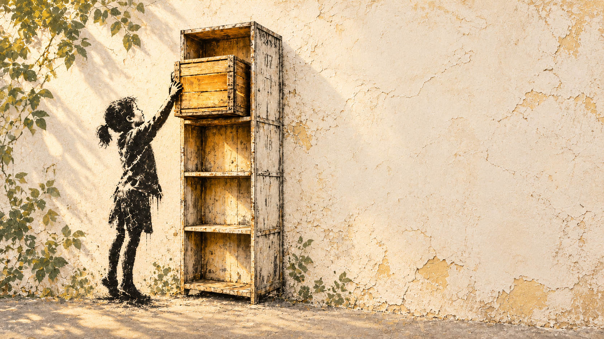

# Кладовка: светлый стритарт

Пять оригинальных иллюстраций с тёплой стеной, угольным трафаретом, шалфейными и медовыми акцентами. Персонажи заняты дружелюбными повседневными делами: складывают вещи, открывают дверь, играют и наводят порядок.

- [Шкаф и ящик](kladovka-locker.png) — обложка презентации.
- [Облако-шар](kladovka-balloon.png) — заключительный слайд.
- [Открытая дверь](kladovka-door.png) — руководство пользователя.
- [Мастерская](kladovka-rat.png) — руководство администратора.
- [Тихая стена](kladovka-wall.png) — спокойный фон для собственных материалов.

Исходники созданы встроенным image generation в октябре 2026 года. Размеры: 1672×941, кроме двери 1672×940. Это нативные результаты генерации без увеличения до 4K/Retina. Старый набор для мониторов сохранён в [классической коллекции](../README.md).

[Промпты и референсы](PROMPTS.md) сохраняют художественное задание. Никаких надписей и логотипов в растровых рисунках нет: заголовки презентации остаются редактируемым текстом.
